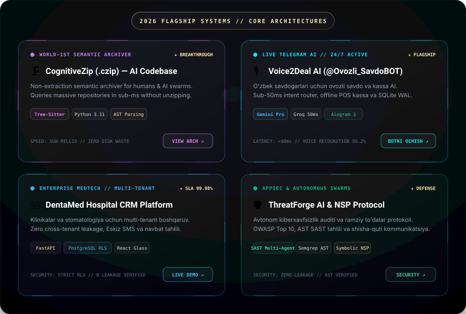
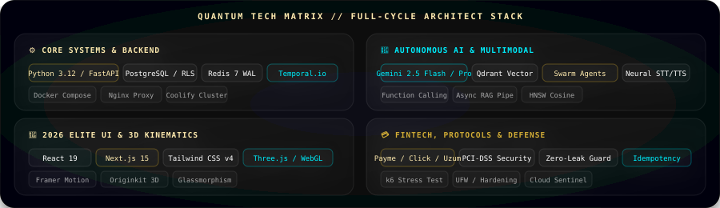

<div align="center">

<!-- 3D COSMIC HOLOGRAPHIC BANNER -->


<br/><br/>

<!-- DYNAMIC TYPING TEXT -->
<a href="https://github.com/salomh46-rgb">
  
</a>

<br/><br/>

<!-- SOCIAL & QUICK CONTACT BADGES -->
<p align="center">
  <a href="https://github.com/salomh46-rgb?tab=followers" target="_blank">
    
  </a>
  &nbsp;
  <a href="https://bestportfoliyo.vercel.app/" target="_blank">
    
  </a>
  &nbsp;
  <a href="mailto:salomh46@gmail.com">
    
  </a>
  &nbsp;
  <a href="https://t.me/Dr_eviluz" target="_blank">
    
  </a>
  &nbsp;
  
</p>

<!-- INTERACTIVE NAVIGATION HUD -->
<p align="center">
  <a href="#-executive-manifesto"></a>
  &nbsp;
  <a href="#-autonomous-quantum-core--telemetry-hud"></a>
  &nbsp;
  <a href="#-featured-flagship-architectures"></a>
  &nbsp;
  <a href="#-flagship-architectural-matrix"></a>
  &nbsp;
  <a href="#-live-enterprise--production-deployments"></a>
  &nbsp;
  <a href="#-daily-autonomous-ai-lab-live-pipeline-telemetry"></a>
  &nbsp;
  <a href="#-quantum-tech-stack-bento-matrix"></a>
  &nbsp;
  <a href="#-systems-architect-identity--production-code-spec"></a>
  &nbsp;
  <a href="#-engineering-metrics--productivity-analytics"></a>
</p>

</div>

---

### ⚡ EXECUTIVE MANIFESTO

> *"Great software is not measured by the lines written, but by the business battles won, the downtime eliminated, and the elegance with which complexity is mastered."*

I design, engineer, and deploy high-concurrency digital platforms, mission-critical autonomous AI swarms, and multi-tenant cloud ecosystems. My methodology connects four distinct disciplines into an unbroken execution loop:
1. **Tier-1 Systems Engineering:** Zero-leakage PostgreSQL RLS architectures, sub-50ms intent routers, asynchronous mutex locks, and distributed workers.
2. **Elite Frontend & Spatial Motion:** Cosmic Quiet Luxury (`#050608`), GSAP ScrollTrigger physics, WebGL/WebGPU shaders, and micro-interactions.
3. **B2B Growth & Commercial Power:** High-converting commercial proposals, merchant acquisition funnels, and real-time voice-to-deal checkout engines.
4. **Software Legal Shield:** Airtight liability waivers (AS IS), civil code risk mitigation, and construction regulatory auditing (QMQ / ShNQ).

---

### 🌌 AUTONOMOUS QUANTUM CORE & TELEMETRY HUD

<div align="center">
  
</div>

<br/>

<div align="center">
  
</div>

---

### 🚀 FEATURED FLAGSHIP ARCHITECTURES

<!-- COSMIC QUIET LUXURY INTERACTIVE SHOWCASE -->
<div align="center">
  <a href="https://bestportfoliyo.vercel.app/" target="_blank">
    
  </a>
</div>

<br/>

<!-- HOLOGRAPHIC 2026 SHOWCASE -->
<div align="center">
  
</div>

<br/>

<!-- INTERACTIVE REPO PILL MATRIX -->
<div align="center">
  <a href="https://github.com/salomh46-rgb/CognitiveZip-.czip-" target="_blank">
    
  </a>
  &nbsp;
  <a href="https://t.me/Ovozli_SavdoBOT" target="_blank">
    
  </a>
  &nbsp;
  <a href="https://t.me/DentaMedKlinika_bot" target="_blank">
    
  </a>
  &nbsp;
  <a href="https://github.com/salomh46-rgb/ThreatForge-AI" target="_blank">
    
  </a>
  &nbsp;
  <a href="https://github.com/salomh46-rgb/uzpayment-monorepo" target="_blank">
    
  </a>
  &nbsp;
  <a href="https://github.com/salomh46-rgb/NSP-Protocol" target="_blank">
    
  </a>
  &nbsp;
  <a href="https://github.com/salomh46-rgb/pulseapi-monitoring-saas" target="_blank">
    
  </a>
  &nbsp;
  <a href="https://github.com/salomh46-rgb/cad-kinetic-engine" target="_blank">
    
  </a>
</div>

---

### 🏛️ FLAGSHIP ARCHITECTURAL MATRIX

| System & Repository | Architecture & Core Stack | Key Innovation & Production Capability | Verified Proof & SLA |
| :--- | :--- | :--- | :---: |
| 🗜️ **[CognitiveZip (.czip)](https://github.com/salomh46-rgb/CognitiveZip-.czip-)** | Python 3.11 • Semantic Tree Sitter • Zero-Extraction AST | World's 1st non-extraction semantic AI codebase archiver. Queries massive codebases in sub-milliseconds without extraction. |  |
| 🎙️ **[Voice2Deal AI](https://t.me/Ovozli_SavdoBOT)** | Google Gemini Multimodal • Fast Groq • SQLite WAL • Aiogram 3 | Real-time voice-to-cart transaction parsing, sub-50ms intent routing, and offline POS auto-reconciliation. |  |
| 🏥 **[DentaMed Hospital CRM](https://t.me/DentaMedKlinika_bot)** | FastAPI • React Glassmorphism • PostgreSQL RLS • Docker | Zero cross-tenant data leakage, dynamic doctor schedules, automated SMS alerts (Eskiz.uz), and patient retention pipelines. |  |
| 🛡️ **[ThreatForge-AI](https://github.com/salomh46-rgb/ThreatForge-AI)** | Autonomous Multi-Agent • AST & Semgrep SAST • Gemini Engine | Proactive AppSec & cybersecurity swarm detecting OWASP vulnerabilities, secret leaks, and logic flaws before merge. |  |
| 💳 **[UzPayment Monorepo](https://github.com/salomh46-rgb/uzpayment-monorepo)** | TypeScript • Python • Click • Payme • Uzum Bank • Paynet | Universal fintech engine with 100x tiyin/so'm conversion guards, idempotency mutex locks, and webhook HMAC verification. |  |
| 🌐 **[NSP-Protocol](https://github.com/salomh46-rgb/NSP-Protocol)** | Rust & Python • Symbolic Logic • Non-Autoregressive | High-density glass-box symbolic communication protocol for autonomous AI swarms, slashing token overhead by 80%. |  |
| 📊 **[PulseAPI Sentry](https://github.com/salomh46-rgb/pulseapi-monitoring-saas)** | FastAPI • ClickHouse / PostgreSQL • Redis Sentinel | Autonomous distributed uptime sentinel, synthetic health checker, and SLA tracking with sub-second alerting. |  |
| ⚙️ **[CAD Kinetic 3D](https://github.com/salomh46-rgb/cad-kinetic-engine)** | Three.js • WebGPU / WebGL • Physics Simulation | Ultra-responsive 3D kinematic engine and architectural mesh visualizer running at constant 60 FPS in browser. |  |

---

### 🌐 LIVE ENTERPRISE & PRODUCTION DEPLOYMENTS

| Infrastructure Tier | Engine & Orchestration | Node / Endpoint | Live Telemetry | Production Guard |
| :--- | :--- | :--- | :---: | :---: |
| ⚡ **Dedicated Cloud VPS** | Hetzner Cloud • Coolify v4.3.21 Orchestrator | `62.171.143.55` (Ubuntu 24.04 LTS) | `Zero Downtime` | UFW Hardened • Fail2Ban |
| 🛡️ **Edge SSL Proxy** | Traefik Reverse Proxy • Let's Encrypt Wildcard | Global Edge Anycast | `A+ SSL Labs` | Automated Certbot Renewal |
| 🗄️ **Database Cluster** | Supabase • PostgreSQL 16 with Row Level Security | Multi-Tenant Isolated Pool | `100% RLS Coverage` | PgBouncer Pool Hygiene |
| 🤖 **Telegram Edge Bots** | Aiogram 3 • Webhook HMAC • AsyncIO Mutex | `@Ovozli_SavdoBOT` & `@DentaMedKlinika_bot` | `Sub-200ms Latency` | Idempotent Concurrency Lock |
| 🌐 **Cosmic Portfolio** | Next.js 15 App Router • Three.js • Tailwind v4 | [`bestportfoliyo.vercel.app`](https://bestportfoliyo.vercel.app/) | `Global CDN Hit 99%` | Cosmic Quiet Luxury UX |

---

<!-- AUTONOMOUS_LAB_START -->
### 🔬 DAILY AUTONOMOUS AI LAB (LIVE PIPELINE TELEMETRY)

> *24/7 Autonomous Engineering Sentinel. Every 24 hours at 00:00 UTC, the autonomous agent designs, verifies, and deploys a production-grade algorithmic utility with 100% test coverage.*

| Cycle | Architecture Module | Functional Specification | Test Proof | Status |
| :--- | :--- | :--- | :---: | :---: |
| 🚀 **Day-317** | [`day_317_hmac_replay_sentinel`](autonomous_lab/day_317_hmac_replay_sentinel) | HMAC-SHA256 Webhook Verifier with Replay Protection | `100% Passed` |  |
| 🚀 **Day-316** | [`day_316_lru_ttl_cache`](autonomous_lab/day_316_lru_ttl_cache) | Thread-Safe LRU Cache with Granular TTL Expiration | `100% Passed` |  |
| 🚀 **Day-315** | [`day_315_token_bucket_limiter`](autonomous_lab/day_315_token_bucket_limiter) | High-Throughput Token Bucket Rate Limiter | `100% Passed` |  |
| 🚀 **Day-314** | [`day_314_async_pubsub_event_bus`](autonomous_lab/day_314_async_pubsub_event_bus) | Decoupled Async Pub-Sub Event Bus | `100% Passed` |  |
| 🚀 **Day-313** | [`day_313_priority_task_queue`](autonomous_lab/day_313_priority_task_queue) | Priority Task Queue with Starvation Defense | `100% Passed` |  |
<!-- AUTONOMOUS_LAB_END -->

---

### ⚡ QUANTUM TECH STACK BENTO MATRIX

<div align="center">
  
</div>

---

### 🌌 SYSTEMS ARCHITECT IDENTITY & PRODUCTION CODE SPEC

```typescript
interface FullCycleProductArchitect {
  name: "Javohirbek Asqarov (Jasper)";
  role: "Full-Cycle Product Architect & AI Systems Founder";
  coordinates: "Tashkent, Uzbekistan 🇺🇿 [41.2995° N, 69.2401° E]";
  four_quadrants: {
    engineering: [
      "FastAPI", "Python 3.11+", "Next.js 15 (App Router)", "TypeScript", 
      "PostgreSQL (Strict RLS)", "Supabase", "Redis Sentinel", "Docker", "PgBouncer", "Temporal.io"
    ];
    frontend_motion: [
      "Cosmic Quiet Luxury (#050608)", "Tailwind CSS v4", "shadcn/ui", 
      "GSAP ScrollTrigger", "Three.js / WebGL", "2026 Elite UI Engine"
    ];
    b2b_growth: [
      "Autonomous B2B Outreach", "Voice-to-Commerce Conversion", 
      "Merchant Acquisition", "ROI-Driven Commercial Proposals", "Omnichannel Lead Funnels"
    ];
    legal_protection: [
      "Software Legal Shield", "Liability Waivers (AS IS)", 
      "QMQ/ShNQ Construction Auditing", "Civil Code Risk Mitigation"
    ];
  };
  methodology: "5-Step Full-Cycle Discipline: Purpose & MVP Gate ➔ Architecture & Edge Defense ➔ Surgical Code ➔ Doubt-Driven Verification ➔ 1-Click DevOps";
  mission: "Bridging mission-critical software engineering with high-ticket commercial execution, legal protection, and autonomous AI swarms.";
  flagships: [
    "CognitiveZip (.czip) Semantic Archiver", 
    "Voice2Deal AI (@Ovozli_SavdoBOT)", 
    "DentaMed Hospital CRM (@DentaMedKlinika_bot)", 
    "ThreatForge AI SAST Sentinel", 
    "UzPayment FinTech Monorepo", 
    "NSP-Protocol Symbolic Swarms",
    "Coolify Dedicated Cluster (62.171.143.55)"
  ];
}
```

---

### 🐍 ACTIVE CONTRIBUTION GRAPH

<div align="center">
  <picture>
    <source media="(prefers-color-scheme: dark)" srcset="https://raw.githubusercontent.com/salomh46-rgb/salomh46-rgb/output/github-contribution-grid-snake-dark.svg">
    <source media="(prefers-color-scheme: light)" srcset="https://raw.githubusercontent.com/salomh46-rgb/salomh46-rgb/output/github-contribution-grid-snake.svg">
    
  </picture>
</div>

---

### 📊 ENGINEERING METRICS & PRODUCTIVITY ANALYTICS

<div align="center">
  
  
</div>

<br/>

<div align="center">
  
</div>

---

<br/>

<div align="center">
  <b>✨ "Engineering bulletproof systems from raw idea to market dominance." ✨</b><br/>
  <sub>© 2026 Javohirbek Asqarov (Jasper) • Full-Cycle Product Architect &amp; AI Systems Founder</sub>
</div>
